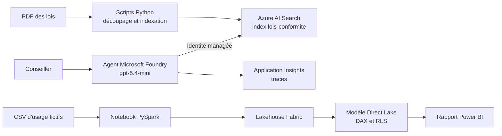

# Assistant Conformité sur Azure

Projet personnel de démonstration : un agent RAG qui aide des conseillers bancaires à trouver des réponses sourcées dans les lois marocaines 31-08 et 103-12. Il répond en français ou en arabe, cite ses sources et refuse les questions hors périmètre. Il s'agit d'un prototype, pas d'un système en production.

**Démonstration :** [regarder la vidéo muette](docs/demo.mp4)

La vidéo montre, dans l'ordre :

1. Une question sur un seuil fixé par décret, avec les citations de la loi et du décret.
2. Une question en arabe, puis la trace de recherche qui montre la requête envoyée en français.
3. Un refus hors périmètre.
4. Le rapport Power BI sur des données d'usage fictives.
5. Le test de sécurité au niveau des lignes (RLS), sans rôle puis avec le rôle `Region`.

## Architecture



## Ce qui a été réalisé

- **Agent Foundry :** `gpt-5.4-mini`, un seul outil Azure AI Search, recherche web retirée.
- **Connexion à AI Search :** identité managée du projet et RBAC Microsoft Entra ID, sans clé dans le code.
- **Ingestion Python :** 437 passages, soit 206 articles de la loi 31-08, 196 de la loi 103-12 et 23 du décret n° 2-12-503.
- **Instructions de l'agent :** citations par article, distinction loi/décret, refus normalisé, renvoi vers la Conformité.
- **Volet Fabric :** données fictives, contrôles de qualité PySpark, modèle en étoile, 8 mesures DAX, RLS dynamique, rapport Power BI et requêtes SQL.
- **Tests :** 20 tests automatisés avec `pytest`.

## Résultats mesurés

Ces résultats portent sur un petit jeu de 15 questions choisies à la main. Ils ne constituent pas une preuve générale de qualité.

| Mesure | Résultat |
|---|---|
| Rappel à 5, questions en français | 11/11 |
| Rappel à 5, questions en arabe sans traduction | 2/4 |
| Rappel à 5, questions en arabe avec traduction de la requête | 4/4 |

Le rappel a été mesuré avec `scripts/rechercher.py`, qui utilise une recherche hybride. L'agent, lui, utilise une recherche par mots-clés (voir [Limites](#limites)).

Tests manuels de l'agent en version 4 :

| Cas | Résultat |
|---|---|
| Hors périmètre (virement SWIFT) | Refus normalisé |
| Tentative de manipulation (météo) | Refus normalisé |
| Seuil fixé par décret | 3 000 dirhams, article 12 de la loi et article 28 du décret |

Pour la version 4, 4 questions en arabe ont été posées dans des conversations séparées. Les réponses et les citations ont été vérifiées dans les textes, et les requêtes de recherche ont été lues dans les traces.

## Volet Fabric et Power BI

Toutes les données du dossier `fabric/raw` sont **fictives**. Elles simulent l'usage de l'assistant.

- **Notebook `01_preparer_donnees` :** doublons et valeurs invalides traités, contrôles bloquants avant l'écriture des tables Delta. 25 lignes sont isolées dans `rejets_questions`.
- **Modèle `sm_conformite` :** Direct Lake, table de faits `fact_questions` et 3 dimensions.
- **Mesures DAX :** volume, refus, escalades, satisfaction, part en arabe, latence moyenne, latence P95 et coût estimé.
- **RLS :** le rôle `Region` filtre `dim_agence` à partir de `USERPRINCIPALNAME()` et de la table `habilitations`.
- **SQL :** requêtes par région, thème, mois et langue dans `fabric/requetes.sql`.

Le notebook `02_tester_rls` exécute la même requête DAX de deux façons :

| Contexte | Résultat |
|---|---|
| Sans rôle | 6 régions, 4 975 questions |
| Rôle `Region` | 1 région, Casablanca-Settat, 1 214 questions |

## Choix techniques

- **Pas d'indexeur Azure :** au niveau Free, il tronque chaque document à environ 32 000 caractères, alors que chaque loi en compte plus de 140 000.
- **Séparation des notes de bas de page :** la loi 31-08 y reproduit des articles du décret n° 2-12-503, avec leurs propres numéros. Un découpage naïf attribuerait par exemple l'article 23 du décret à la loi, et la citation serait fausse.
- **Coquilles conservées ou corrigées :** « Article 3l » est lu comme l'article 31. La première note écrit « 2-15-503 », les suivantes « 2-12-503 » : le texte reste tel quel, et les métadonnées utilisent 2-12-503.
- **Traduction des requêtes en arabe :** les PDF sont en français. Une requête en arabe trouvait mal les articles par mots-clés, d'où la consigne de chercher en français.
- **Identité fixe pour le modèle Fabric :** le test de rôle était refusé avec le SSO par défaut. La connexion utilise une identité fixe, recommandée par Microsoft avec la RLS.

## Limites

- Les réponses en arabe s'appuient sur des textes en français et doivent être validées par une personne.
- L'agent fait une recherche par mots-clés : l'index n'a pas de vectoriseur et le niveau Free ne propose pas le classement sémantique. Un vectoriseur demanderait une clé, car ce niveau n'offre pas d'identité managée.
- Les textes ne couvrent pas les circulaires de Bank Al-Maghrib ni d'éventuelles modifications ultérieures.
- La RLS a été vérifiée avec un seul compte réel. Dans ce dépôt, les adresses de `habilitations` sont fictives.
- La RLS du modèle ne protège pas le point de terminaison SQL : les utilisateurs filtrés doivent avoir un rôle Lecteur, sans accès direct au Lakehouse. Les rôles Admin, Membre et Contributeur ne sont pas soumis à la RLS.
- La page « Tester en tant que rôle » est restée vide : le test a été fait par notebook.
- Fabric Data Agent n'a pas pu être créé sur la capacité d'essai.
- L'agent n'est pas connecté à Copilot Studio dans ce dépôt. Un agent Copilot Studio avec escalade a été construit séparément, mais son export n'est pas publié à ce jour.

## Organisation du dépôt

```text
agent/              instructions de l'agent
data/               textes découpés
docs/               vidéo de démonstration
fabric/             données fictives, notebooks, SQL et DAX
scripts/            découpage, indexation et évaluation
tests/              tests automatisés
```

## Lancer le projet

Prérequis : Python 3.10 ou plus, Azure CLI, un service Azure AI Search et un déploiement `text-embedding-3-small`.

```powershell
py -m venv .venv
.\.venv\Scripts\Activate.ps1
pip install -r requirements.txt
Copy-Item .env.example .env
az login --tenant <votre-tenant>
python scripts\indexer.py
python scripts\verifier_recherche.py
python -m pytest -q
```

Pour refaire le découpage, placer les deux PDF dans `data\pdf\`, puis lancer `python scripts\decouper_lois.py`.

## English summary

Personal demo project: a RAG agent that helps bank advisers find sourced answers in Moroccan laws 31-08 and 103-12, in French or Arabic. It is a prototype, not a production system.

- **Agent:** Microsoft Foundry and Azure AI Search, connected with a managed identity and Microsoft Entra ID RBAC.
- **Ingestion:** 437 passages split by article, with the decree separated from the laws so citations stay reliable.
- **Evaluation:** 15 hand-picked questions. Recall@5 is 11/11 in French, and 2/4 then 4/4 in Arabic after query translation.
- **Analytics:** Fabric Lakehouse, PySpark, Direct Lake semantic model, DAX, dynamic RLS and Power BI, using fictional usage data.
- **Main limits:** keyword search in the agent, human validation required for Arabic answers, Fabric Data Agent unavailable on the trial capacity.
